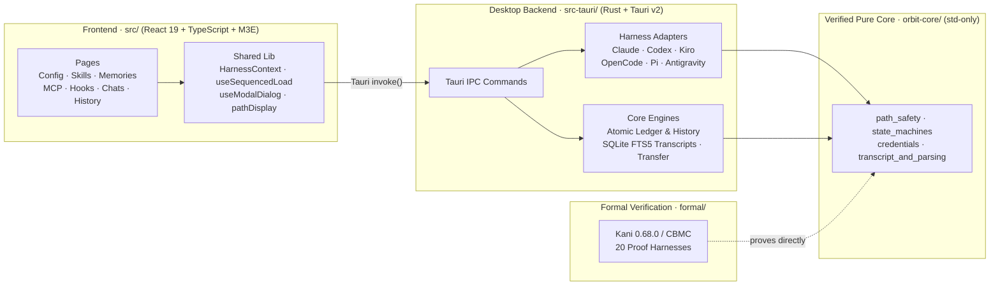

<div align="center">
  
  <h1>Orbit</h1>
  <p><strong>A local-first desktop control plane for your AI coding agents.</strong></p>
  <p>Manage configuration, skills, memories, MCP servers, hooks, setup backups, and chat archives across every major CLI agent — with atomic writes, full version history, and formally verified core invariants.</p>

  <p>
    <a href="https://github.com/RoyCoding8/Orbit/actions/workflows/ci.yml"></a>
    <a href="LICENSE"></a>
    <a href="https://v2.tauri.app/"></a>
    <a href="https://www.rust-lang.org/"></a>
    <a href="formal/README.md"></a>
  </p>

  <p>
    <a href="#features">Features</a> ·
    <a href="#agent-support">Agent Support</a> ·
    <a href="#architecture">Architecture</a> ·
    <a href="#formal-verification">Formal Verification</a> ·
    <a href="#quick-start">Quick Start</a> ·
    <a href="docs/reference.md">Reference Docs</a>
  </p>
</div>

## Supported Agents

**Claude Code** · **OpenAI Codex** · **Kiro** · **OpenCode v2** · **Pi** · **Antigravity**

Orbit reads and writes each agent's native on-disk formats directly (JSON, JSONC, TOML, Markdown, SQLite, JSONL) without locking you into a proprietary wrapper.

## Features

| Capability | What Orbit Does |
|---|---|
| **Skills** | Discover local, project, and shared skills; edit `SKILL.md` with live Markdown preview; install, uninstall, and restore previous versions. |
| **Memories & Instructions** | Inspect hierarchical `AGENTS.md`, `CLAUDE.md`, `GEMINI.md`, and auto-memory catalogs; collapse project groups, edit sections, and follow linked files. |
| **MCP Servers** | Configure stdio and HTTP/SSE MCP servers, preserve unknown native fields, mask credentials in the UI, and run live connection benches. |
| **Settings & Hooks** | Layer-aware inspection (user / project / local) preserving JSONC & TOML comments, nested JSON expansion, and interactive command-hook testing. |
| **Chats & Conversion** | Browse sessions by project, lazy-load threads on demand, build SQLite FTS5 message search, export/import native archives, convert across agents, and delete with mandatory backup. |
| **Setup Backups** | Selectively export skills, hooks, MCP servers, memories, and settings to checksummed ZIP archives with conflict-aware import previews. |
| **Atomic History & Undo** | Every write uses temp-file staging, checksum pre-images, and a durable ledger so you can restore prior file or directory versions at any time. |

## Agent Support

| Area | Claude Code | Codex | Kiro | OpenCode v2 | Pi | Antigravity |
|---|:---:|:---:|:---:|:---:|:---:|:---:|
| **Settings** | JSON layers | TOML layers | JSON layers | JSON / JSONC | JSON layers | CLI JSON |
| **Skills** | Full + toggle | Full + toggle | Full | Full | Full | Full + manifests |
| **Memories & Instructions** | Auto-memory + `CLAUDE.md` | Shared + `AGENTS.md` | Steering + `AGENTS.md` | `AGENTS.md` + local | Hierarchy + `SYSTEM.md` | Rules + `AGENTS`/`GEMINI` |
| **MCP Servers** | Local & HTTP | Local & HTTP | Local & HTTP | Native v2 | Local & HTTP | Shared local & HTTP |
| **Hooks** | Edit, toggle, test | Edit, test | V2/V3 + `.kiro/hooks` | Via Settings | Via Settings | Named groups + test |
| **Chat Archives** | Export / Import | Export / Import | V2 export only | Native v2 CLI | JSONL v3 | App & CLI (`agy 1.5`) |
| **Chat Conversion** | Source & Dest | Source & Dest | Source only | Source & Dest | Source & Dest | Source & CLI Dest |
| **Chat Deletion** | With backup | With backup | — | Leaf chats | With backup | Inactive unlinked |

See the full [Agent Support & Format Reference](docs/reference.md#agent-support) for per-agent nuances, paths, and limits.

## Architecture

Orbit separates its pure security and state-machine invariants into a zero-FFI `orbit-core` crate shared by both the desktop backend and the Kani formal verification suite:



### Repository Layout

```text
Orbit/
├── src/                  # React 19 + TypeScript UI (components/, lib/, pages/, styles/)
├── tests/frontend/       # Vitest + Testing Library suites (15 files, 154 tests)
├── src-tauri/            # Tauri v2 Rust backend (harness/, transcript/, transfer/, schemas/)
├── orbit-core/           # Pure-std shared crate (zero Tauri/SQLite/OS FFI)
├── formal/               # Standalone Kani 0.68.0 formal proof suite + run.sh
├── docs/                 # Deep reference documentation
└── assets/               # README icon artwork
```

## Formal Verification

Core security, state-machine, credential-masking, and parsing invariants in `orbit-core/` are mathematically verified with [Kani](https://model-checking.github.io/kani/) 0.68.0 (CBMC 6.11.0)—directly against the exact production functions linked by `src-tauri/`:

| Module | Harnesses | Verified Properties |
|---|---:|---|
| `path_safety.rs` | 6 | Lexical containment, `..`/Windows reserved device/ADS rejection, backup-root confinement, archive image allowlist, case-insensitive collision folding, `~/` & `..` link normalization |
| `state_machines.rs` | 5 | Ledger operation state resolution, superseded-pending classification, monotonic `op_id`/backup uniqueness, stale-checksum & preimage restore preconditions |
| `credentials.rs` | 4 | Dash-prefixed `credential_flag` precision, case-insensitive HTTPS/SSE checks, masked placeholder restoration & fresh-placeholder rejection, secret-key classification |
| `transcript_and_parsing.rs` | 5 | Panic-free UTF-8 `parse_checksum` roundtrip, BOM/CRLF/unclosed frontmatter parsing, cycle-safe iterative spine ordering, collision-free `unique_title`, bounded stream caps |

Run all 20 proofs locally:

```sh
./formal/run.sh
```

See [`formal/README.md`](formal/README.md) for the full invariant catalog, mutation-testing audit, and proof-to-test mapping.

## Quick Start

**Prerequisites:** Node.js 22+, stable Rust (1.82+), and the [Tauri v2 platform prerequisites](https://v2.tauri.app/start/prerequisites/). Install whichever native agent CLIs you use (OpenCode requires v2).

```sh
npm ci
npm run tauri dev
```

On Windows, use either Rust GNU with MinGW-w64 GCC/G++ or Rust MSVC with the Microsoft C++ Build Tools. See [platform setup](CONTRIBUTING.md#platform-setup).

## Building Release Packages

| Platform | Command | Output Package |
|---|---|---|
| **Windows** | `npm run tauri build` | NSIS installer (`.exe`) |
| **Linux** | `npm run tauri build -- --bundles deb,rpm,appimage` | `.deb`, `.rpm`, `.AppImage` |
| **macOS** | `npm run tauri build -- --bundles app,dmg` | `.app` bundle, `.dmg` |

Packages are written to `src-tauri/target/release/bundle/`.

## Verification & Checks

```sh
# Frontend build & tests
npm run build
npm test

# Rust formatting, lints, & unit/integration tests
cargo fmt --manifest-path orbit-core/Cargo.toml --check
cargo fmt --manifest-path src-tauri/Cargo.toml --check
cargo clippy --manifest-path orbit-core/Cargo.toml -- -D warnings
cargo clippy --manifest-path src-tauri/Cargo.toml -- -D warnings
cargo test --manifest-path src-tauri/Cargo.toml

# Formal verification (requires Kani 0.68.0)
./formal/run.sh
```

## Documentation

- **[Agent Support & Reference](docs/reference.md)** — per-agent configuration paths, chat archive/conversion rules, setup backup limits, and execution security model
- **[Formal Verification Guide](formal/README.md)** — Kani proof harnesses, mutation-testing results, and proof-to-removed-test mapping
- **[Contributing Guide](CONTRIBUTING.md)** — platform toolchains, CI checks, and optional live-CLI integration tests
- **[Changelog](CHANGELOG.md)** — release history

## License

Licensed under the [Apache License 2.0](LICENSE).
